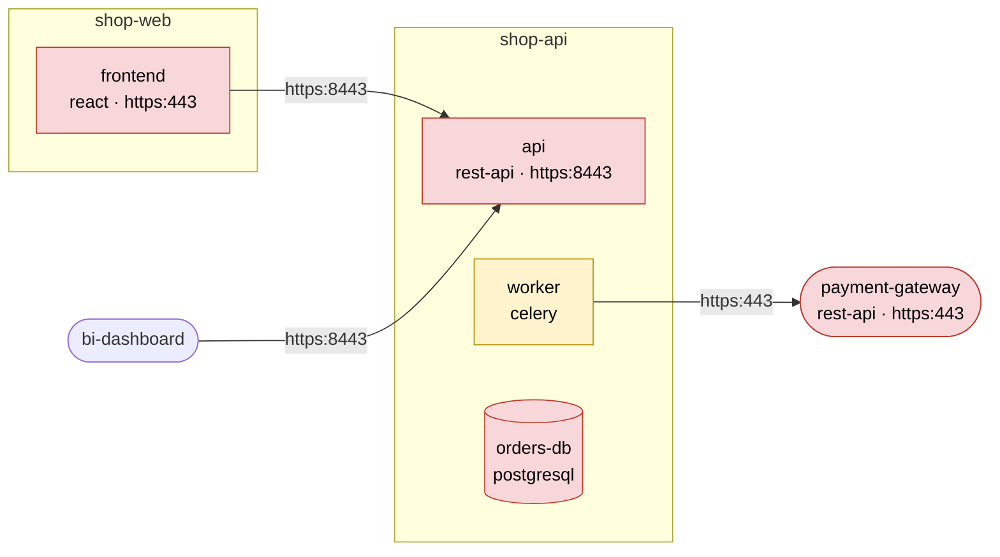

<!-- Generated by catalog-parser from catalog/dependencies.yml. Do not edit by hand. -->
# Dependency map — shop-api

Orders and payments API of the web shop

`A --> B` means *A depends on B*. The label is the provider's protocol and port; `via X` marks indirect access.
Colour is the component's criticality (red high, yellow medium, green low). Cylinders are data components;
rounded boxes outside the repository box are external systems or consumers without a catalog.
